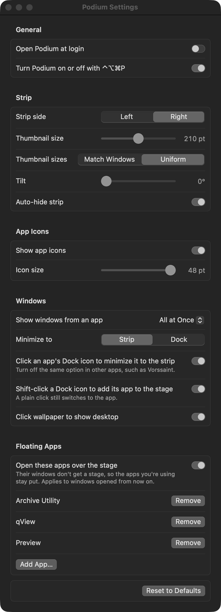

<p align="center"></p>

# Podium: a Stage Manager alternative for macOS

Podium is a free, open-source menu bar app that replaces Apple's Stage Manager. Put the strip of recent windows on the **left or the right** of your screen, minimize windows to the strip instead of the Dock, and change how the strip looks. It needs no SIP changes and never moves your Dock.

Podium is not affiliated with or endorsed by Apple. "Stage Manager" is a trademark of Apple Inc.

## Why Podium

- **Choose the side.** Apple's Stage Manager keeps its strip on the left edge. Podium puts it on the left or the right, and you can switch from the menu bar at any time.
- **Change the look.** Set the thumbnail size and shape, the tilt, and the app icon size.
- **Minimize to the strip.** The minimize button, a Dock click, or a drag by the title bar sends a window to the strip. It returns when you click it.
- **Your windows stay safe.** Podium records every window it hides and restores them if it ever quits or crashes.

## Install

**Download:** get `Podium-<version>.dmg` from the [Releases](../../releases) page, open it, and drag Podium to Applications.

Releases are not notarized yet, so macOS shows an "unidentified developer" warning the first time. To open the app anyway, right-click Podium in Applications and choose Open, or go to System Settings > Privacy & Security and click Open Anyway.

**Or build it yourself:** see [Build from source](#build-from-source).

Requires macOS 14 or later. Developed on macOS 27.

## First launch

Podium asks for two permissions:

- **Accessibility** lets Podium move and raise windows.
- **Screen Recording** lets Podium take a picture of a window as it leaves the stage, for its strip thumbnail. Pictures stay in memory and are never saved or sent anywhere. macOS shows its screen-sharing indicator for a few seconds after each switch, and not while Podium is idle or while you hover the strip.

Turn Apple's Stage Manager off first (System Settings > Desktop & Dock). Podium will not run while it is on.

## What it does

- Shows a strip of your recent windows on one edge, with piles of up to three windows per app and the app icon on each item.
- Click an item to bring its windows on stage. Shift-click adds it to the current stage. Drag an item onto the stage to combine them.
- Drag a window by its title bar into the strip, or minimize it, to put it in the strip.
- Click the wallpaper to show the desktop, and click it again to bring your windows back.
- Hides the strip when a window covers it, and shows it again when your pointer reaches the edge.
- Opens the windows of apps on your floating list (Archive Utility, qView and Preview by default) over the stage without changing it.

## Settings

Open **Settings** from the Podium icon in the menu bar. **Strip side**, **Minimize to**, **Auto-hide** and **Restore All Windows** are also in that menu.



| Option | What it does | Default |
|---|---|---|
| Open Podium at login | Starts Podium when you log in. | Off |
| Turn on or off with Control-Option-Command-P | A global hotkey that turns Podium on or off. | On |
| Strip side | Puts the strip on the left or the right edge. | Right |
| Thumbnail size | Width of the largest thumbnail, 100 to 320 pt. | 290 pt |
| Thumbnail sizes | Match Windows scales every window by the same amount, so small windows stay small. Uniform fits every window to the same box. | Match Windows |
| Tilt | Angles the thumbnails, 0 to 30 degrees. | 17 degrees |
| Auto-hide strip | Hides the strip while a window covers it. | On |
| Show app icons | Shows the app icon on each strip item. | On |
| Icon size | Size of the app icon, 16 to 48 pt. | 40 pt |
| Show windows from an app | All at Once puts all of an app's windows on stage together. One at a Time shows one window per click. | All at Once |
| Minimize to | Sends minimized windows to the strip, or to the Dock as macOS normally does. | Strip |
| Click an app's Dock icon to minimize it to the strip | Clicking the front app's Dock icon sends its windows to the strip. Turn off the same option in other apps. | Off |
| Shift-click a Dock icon to add its app to the stage | Adds an app from the strip to the current stage. A plain click still switches to the app. | On |
| Live thumbnails | Keeps the strip thumbnails updating all the time. macOS shows its screen-sharing indicator the whole time. Off, a window is captured only as it leaves the stage. | Off |
| Click wallpaper to show desktop | Clears the stage when you click the wallpaper, and brings it back on a second click. | On |
| Floating Apps | Windows of the listed apps open over the stage and leave it alone. Add or remove apps from the list. | On: Archive Utility, qView, Preview |

**Reset to Defaults** at the bottom of the window restores every option above.

## Questions

**How do I move the Stage Manager strip to the left or right?**
Install Podium, turn off Apple's Stage Manager, then choose **Strip on Left** or **Strip on Right** from the Podium menu bar icon.

**Does Podium work with more than one display?**
The strip and its animations are on the main display only. Windows on other displays are hidden and brought back without the flying thumbnails.

**Does Podium need SIP disabled?**
No. It uses the Accessibility and Screen Recording permissions only.

**Can I run it next to Apple's Stage Manager?**
No. Podium waits until Apple's Stage Manager is off. The menu bar icon has an item to turn Apple's back on.

**What happens to my windows if Podium crashes?**
Podium writes each hidden window to a file and puts them back on the next launch. **Restore All Windows** in the menu does it immediately.

**Why does macOS show its screen-sharing indicator?**
macOS shows it after any app takes a picture of the screen, even a single screenshot. By default Podium captures one window per stage switch, so the indicator appears for a few seconds after a switch and never while you are idle or hovering the strip. Turning on Live thumbnails in Settings keeps it on.

**Why does macOS warn me when I open it?**
The download is not notarized yet, which needs a paid Apple Developer ID. Building from source avoids the warning.

## Build from source

You need the Swift 6 toolchain (Xcode or the Command Line Tools).

```bash
scripts/make-dev-cert.sh   # once: a local code-signing identity, so macOS keeps your permissions across rebuilds
scripts/run.sh             # builds build/Podium.app, signs it and launches it
scripts/test.sh            # runs the tests
scripts/make-dmg.sh        # builds build/Podium-<version>.dmg
```

Set `PODIUM_SIGN_IDENTITY` to use a different signing identity (`-` for ad-hoc). Ad-hoc signing makes macOS forget the permissions on every rebuild.

## Uninstall

Quit Podium from the menu bar, delete it from Applications, and remove its settings and parking file:

```bash
defaults delete dev.podium.Podium
rm -r ~/Library/Application\ Support/Podium
```

## How it is built

`PodiumCore` is a pure Swift library with the stage model, strip layout and safety logic, and it has no AppKit dependency. `Podium` is the menu bar app on top of it. The notes in [`docs/research`](docs/research) record how Apple's Stage Manager decides what goes on stage and in the strip, and the values Podium takes from it.

Contributions are welcome. Read [CONTRIBUTING.md](CONTRIBUTING.md) first.

## License

[MIT](LICENSE)
